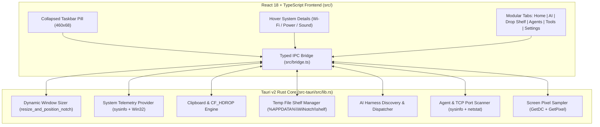

# WiNotch Technical Architecture

## Overview

WiNotch combines a **Tauri v2 Rust backend** (`src-tauri/src/lib.rs`) for direct Win32 OS integration with a **React 18 + TypeScript frontend** (`src/App.tsx`) for fluid 60fps UI animations and modular card/tab management.

---

## Key Backend Subsystems (`src-tauri/src/lib.rs`)

### 1. Dynamic Top-Center Window Management
- Instead of covering the entire screen with an invisible window or polling cursor coordinates across threads, [`resize_and_position_notch`](../src-tauri/src/lib.rs) dynamically resizes the borderless, topmost tool window (`skipTaskbar: true`, `decorations: false`, `transparent: true`, `alwaysOnTop: true`) to match the current UI mode:
  - **Collapsed Pill Mode**: `460 × 68` logical DIPs, centered at `y = 0`.
  - **Expanded Panel Mode**: `760 × 490` logical DIPs (or `760 × 624` when the AI drawer is expanded), centered at `y = 0`.
  - **Passive Game Bar Mode**: `568 × 30` logical DIPs, centered at `y = 0`.
- This guarantees that when collapsed, clicks anywhere outside the `460 × 68` pill go directly to underlying Windows 11 applications with zero CPU overhead.

### 2. Native Windows File Clipboard (`CF_HDROP`)
- Implemented in [`write_clipboard_files_cf_hdrop`](../src-tauri/src/lib.rs):
  - Allocates movable global memory via Win32 `GlobalAlloc(GMEM_MOVEABLE | GMEM_ZEROINIT, total_bytes)`.
  - Writes a 20-byte `DROPFILES` header (`pFiles = 20`, `fWide = 1` for UTF-16) followed by a double-null-terminated sequence of UTF-16 file paths (`path1\0path2\0\0`).
  - Publishes the handle to the Windows Clipboard via `OpenClipboard`, `EmptyClipboard`, `SetClipboardData(CF_HDROP, hglobal)`, and `CloseClipboard`.
  - Enables standard **`Ctrl + V`** file pasting in Windows File Explorer, Desktop, browsers, and chat apps.

### 3. System Telemetry & Quick Controls
- **Battery**: Uses `windows_sys::Win32::System::Power::GetSystemPowerStatus` for sub-millisecond reads of `BatteryLifePercent`, `ACLineStatus`, and `SystemStatusFlag`.
- **Wi-Fi**: Parses `netsh wlan show interfaces` (with an 8-second cache and `CREATE_NO_WINDOW`) to extract connected SSID, signal quality, `802.11` radio type, band, and RX/TX Mbps.
- **Power Mode**: Invokes `powercfg /setactive <scheme-guid>` to switch between *Best Power Efficiency*, *Balanced*, and *Best Performance*.
- **Audio & Media Keys**: Dispatches `VK_VOLUME_UP`, `VK_VOLUME_DOWN`, `VK_VOLUME_MUTE`, `VK_MEDIA_PLAY_PAUSE`, `VK_MEDIA_NEXT_TRACK`, and `VK_MEDIA_PREV_TRACK` via Win32 `keybd_event`.

### 4. AI Harness Auto-Discovery
- [`discover_harnesses`](../src-tauri/src/lib.rs) inspects `%LOCALAPPDATA%\Programs`, `%APPDATA%\npm`, `%USERPROFILE%\.local\bin`, and `where.exe` (`PATH`) to detect installed desktop apps and CLIs (**Antigravity**, **Claude Code**, **OpenCode**, **Ollama**, **VS Code**, **Codex**, **Cursor**) alongside cloud web targets.
